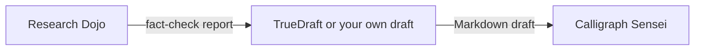

# Architecture

Skill Dojo holds standalone skills with clear responsibilities. Each works alone. None requires another.

## Skill Boundaries

| Skill | Owns | Does not own |
|---|---|---|
| [Research Dojo](../skills/research-dojo/README.md) | Fact-checking, source and date checks, claim stress-testing, research synthesis | Drafting, style polishing |
| [TrueDraft](../skills/truedraft/README.md) | Assignment planning, outline gates, academic drafting, citation-aware workflows | Evidence auditing, final style refinement |
| [Calligraph Sensei](../skills/calligraph-sensei/README.md) | Proofreading, voice-preserving polish, style audits, preservation checks | Structuring arguments, managing citations, checking facts |

## Optional Workflow

Any step can be skipped, and any skill can be used with other tools.

## Generic Interfaces

Skills work with each other, and with any long-form writing workflow, through plain conventions instead of direct dependencies.

| Convention | Rule |
|---|---|
| Input | Plain Markdown or text |
| Default behavior | Read-only checks |
| Author's text | Never overwritten without a request and a snapshot |
| Reports | `fact-check/<name>.factcheck.md` and `.json`, `style-review/<name>.lint.md` |
| Inline flags | `[CITE: ...]`, `[UNVERIFIED ...]`, `[CONTRADICTED ...]`, `[DISPUTED ...]`, `[DATE: ...]`, `[SOURCE ...]` |
| Flags from other tools | Preserved verbatim |
| Project rules | An existing style guide or voice notes outrank skill defaults |
| Honesty | Nothing is reported as verified unless a source was actually checked |

## Independence Rules

- A skill never imports or calls another skill's files.
- Shared helpers are copied into each skill, and `scripts/validate-structure` keeps the copies identical.
- Scripts use only the Python standard library. Optional tools are detected, never required.
- A skill may suggest a companion for out-of-scope work, but must still work without it.

## Related Documentation

- [Installation](installation.md)
- [Release policy](releases.md)
- [Suite changelog](../CHANGELOG.md)
- [Third-party notices](../THIRD_PARTY_NOTICES.md)
