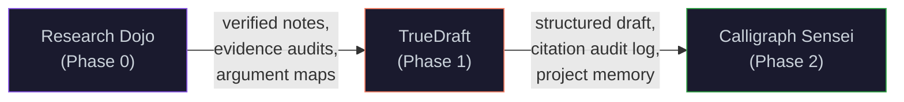

# Architecture

## Scope

Skill Dojo contains standalone skills with explicit responsibilities and optional handoffs. A skill must not silently absorb another skill's responsibilities.

## Skill Boundaries

| Skill | Owns | Does Not Own |
|---|---|---|
| [Research Dojo](../skills/research-dojo/README.md) | Evidence discovery, claim stress-testing, debate mapping, research synthesis | Drafting, style polishing, citation formatting |
| [TrueDraft](../skills/truedraft/README.md) | Assignment planning, outline gates, structured academic drafting, citation-aware manuscript workflows | Evidence auditing, final style refinement |
| [Calligraph Sensei](../skills/calligraph-sensei/README.md) | Style refinement, proofreading, readability, semantic-preservation audits | Structuring arguments, managing citations, claim review |

## The Three-Phase Pipeline

### Phase 0 — Research Dojo
Stress-test claims, map active academic debates, audit evidence quality, and produce a high-density synthesis. Output: verified notes, contradiction tables, evidence audits.

### Phase 1 — TrueDraft
Turn research materials into a structured draft. Manages onboarding, outline gates, citation search, originality rewriting, and delivery audit. Output: structured manuscript, citation audit log, project memory files.

### Phase 2 — Calligraph Sensei
Apply final style refinement under one of five modes (Creative, Academic-Formal, General, Conversational, Proofreading). Preserves all evidence, citations, and meaning from the upstream phases.

## Independence Guarantee

Each handoff is optional. Every skill must operate independently when its input is supplied directly by the user. No skill should require another skill to be installed in order to function.

## Cross-Skill References

When a skill detects that a companion skill is installed, it may:
- Pre-populate onboarding from another skill's output (e.g., TrueDraft importing Research Dojo synthesis)
- Recommend running a companion skill for a task outside its own scope
- Respect the companion's output format and preserve its annotations

When a companion is not installed, the skill must gracefully degrade and handle the input on its own.

## Related Documentation

- [Installation guide](installation.md) — per-skill and suite-wide installation
- [Release and versioning policy](releases.md) — independent versioning and changelog conventions
- [Suite changelog](../CHANGELOG.md) — cross-skill and suite-level history
- [Root README](../README.md) — suite overview and quick start
